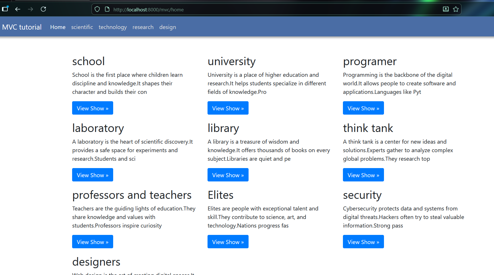
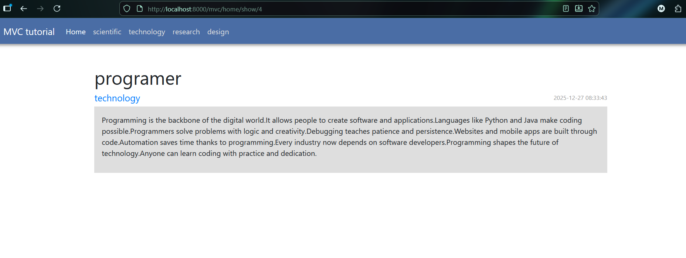
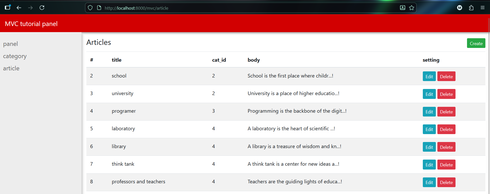
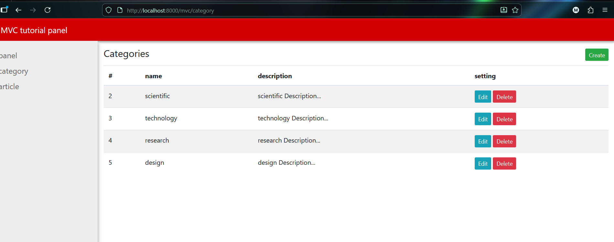
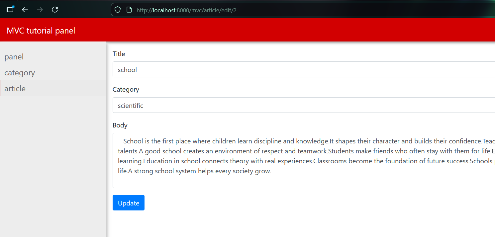
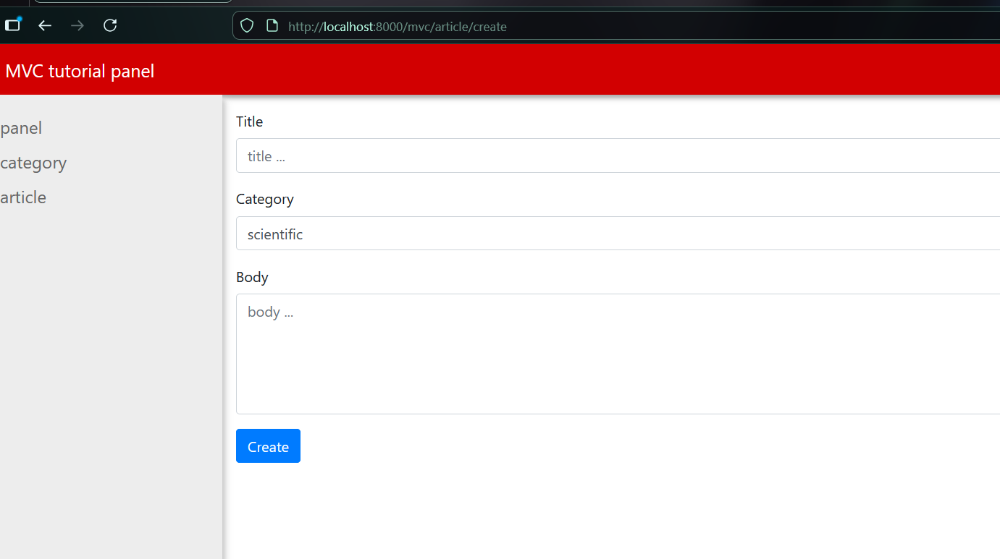

# وبلاگ Tiny MVC 
این پروژه بر پایه‌ی یک فریم‌ورک سبک و اختصاصی MVC به نام **Tiny-MVC** توسعه داده شده است.

این فریم‌ورک با استفاده از زبان PHP و رویکرد برنامه‌نویسی شیءگرا (OOP)، از ابتدا و با هدف یادگیری و اهداف آموزشی پیاده‌سازی شده است.

---

## 📸 تصاویر پروژه

<p align="center">
  
  
</p>

---

### 🔐 پنل مدیریت

<p align="center">
  
  
  
  
</p>

---

## ⚙️ نصب و راه‌اندازی

### ۱. دریافت مخزن پروژه

مخزن پروژه را از گیت‌هاب دریافت کنید.

### ۲. ورود به پوشه پروژه و اجرای سرور داخلی PHP

در ترمینال، دستور زیر را اجرا کنید:

```bash
php -S localhost:8000
